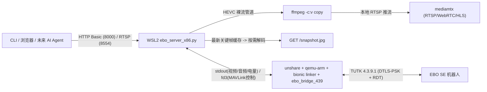

# EBO SE 局域网桥接与控制设计

范围：Enabot EBO SE 机器人的凭据获取、底层 TUTK 协议桥接、x86 非模拟器运行架构与局域网 HTTP 控制 API。读取时机：修改桥接源码、排障连接/域名/结构体兼容问题、评估纯原生 Windows 替代方案，以及后续接入 ChatGPT / MCP 工具前读取。

## 需求与约束

- **核心目标**：在无需手机、不常驻安卓模拟器的前提下，直接在 Windows x86 电脑通过局域网控制 EBO SE（实时看图、移动、回充、查电量），并为后续 ChatGPT / MCP 控制提供简洁的 HTTP 接口。
- **硬件与协议硬约束**：
  - EBO SE 底层使用闭源 ThroughTek TUTK / Kalay 2.0 协议（DTLS-PSK 音视频 + RDT 可靠信道承载 MAVLink 控制与电量状态），目前无成熟可用的纯开源 Kalay 2.0 + RDT 客户端实现。
  - 机器人同一时间仅允许 **1 个** 客户端会话；桥接在线时手机端 ROLA 应用无法同时连接，需提供随时释放与重连能力。
  - 官方 ROLA 2.2.1 安卓安装包（`com.enabot.ebo.intl`，`versionCode=111`）仅提供 `armeabi-v7a` 与 `arm64-v8a` 两种 ARM 动态库，不含 `x86`/`x86_64` 库，且 TUTK SDK 已升级至 `4.3.9.1`。
- **保密与合规约束**：专有二进制库（TUTK `.so`、Android bionic、`ioctl9930.bin`）与所有账号/设备凭据均仅保存于本机忽略目录（`config/`、`local/`），不提交版本库，不写入公共文档。

## 架构与关键流程

流程说明：

1. **进程隔离与指令翻译**：`ebo_server_x86.py` 在 WSL2 中通过 `unshare --pid --fork --mount-proc` 建立低 PID 命名空间，再用 `qemu-arm` 驱动 32 位 Android bionic `linker` 加载 `ebo_bridge_439`，并将控制管道复制到文件描述符 `fd 3` 透传进入子进程。
2. **媒体直通与抓拍**：`ebo_bridge_439` 把收到的 HEVC 帧（codec 80）、G.711 音频帧（`0xA0`）和 RDT 入站 MAVLink 状态（`0xFF`）以定长帧头写入 `stdout`。服务端将 HEVC 帧不经重编码送给 `ffmpeg` 推向 `mediamtx`，同时按关键帧（HEVC VPS/SPS）滚动缓存最新 GOP，响应 `/snapshot.jpg` 时实时解码单帧 JPEG。
3. **控制回传**：HTTP `/move`、`/drive`、`/stop`、`/action/{name}` 组装 MAVLink 帧（`msgid=202` 电机、`msgid=229` 参数开关、`msgid=200` 指令如 `40154` 回充）经 `fd 3` 交给 `ebo_bridge_439`，由 `RDT_Write` 发往机器人；连续遥杆 `/drive` 带 350 ms 服务端看门狗，断连自动急停。

## 决策 1：运行主机与平台选型

状态：当前采用（Windows x86_64 WSL2 + `qemu-arm`）。

- **促成条件**：直接在本机 Windows x86 电脑上脱离安卓模拟器运行并封装局域网 HTTP API，不依赖额外外部硬件主机。
- **选择与理由**：在 Windows 已有的 WSL2（`Ubuntu-22.04`，4 KB 内存页）中使用单进程用户态指令转换 `qemu-arm` 托管桥接。无需运行完整安卓系统或图形模拟器，内存占用低，本机 `127.0.0.1:8000` 与 `8554` 可直接被 Windows 浏览器、脚本和未来 MCP 服务访问。
- **真实代价**：底层仍依赖 Windows 的 WSL2 轻量 Linux 内核虚拟机，且随电脑开关机启停。
- **实际比较或暂缓的方案**：
  - **纯原生 Windows x86 DLL（未采用）**：ROLA 安装包无 x86 库；即便另寻闭源 Windows 版 TUTK 4.3.9.x DLL，商业许可密钥也可能绑定 Android 平台限制，验证不确定性高。
  - **纯开源重写 Kalay 2.0 + RDT（否决）**：逆向与维护成本远高于复用官方库。

## 决策 2：自建双版本兼容底层桥接程序

状态：当前采用。

- **促成条件**：上游参考仓库预编译的 `app/ebo_bridge` 面向 TUTK SDK 4.3.6.x，而官方 ROLA 2.2.1 内置 SDK 4.3.9.1，运行原程序直接报 `IOTC connect -46`。
- **选择与理由**：编写 [ebo_bridge_439.c](../../x86-bridge/ebo_bridge_439.c) 与极简启动桩 [bionic_start.c](../../x86-bridge/bionic_start.c)，在 WSL2 用 `arm-linux-gnueabi-gcc` 直接链接 `local/vendor/bionic/libc.so` 与 `libdl.so` 产出无 NDK 依赖的 32 位 ARM Android PIE 可执行文件 `ebo_bridge_439`。连接时优先按 4.3.9.1 结构体提交，遇 `-46` / `-20000` 自动回退 4.3.6 结构体尺寸。
- **不变量**：不得让项目正式代码依赖 `repo/reference/` 中的参考仓库文件；MIT 许可的前端页面与配置模板已独立整合至 `x86-bridge/`，专有依赖独立存放于 `local/vendor/`。

## 踩坑与排障记录（2026-11-26 实测证实）

### 1. TUTK SDK 4.3.9.1 结构体扩张导致连接报 `-46`

- **触发条件**：用上游预编译 `ebo_bridge` 加载 ROLA 2.2.1 的 `libIOTCAPIs.so`（`4.3.9.1`）。
- **症状**：许可校验与 `RDT_Initialize=128` 均通过，但 `IOTC_Connect_ByUIDEx` 持续返回 `-46`（`IOTC_ER_INVALID_ARG`）。
- **已证实原因**：反汇编 `libIOTCAPIs.so` 与 `libAVAPIs.so` 的 `IOTC_Connect_ByUIDEx`、`avClientStartEx` 及其 JNI 包装函数确认：
  - `St_IOTCConnectInput` 总大小由 `152` 变为 `160`（`0xa0`），`timeout` 字段偏移由 `+144` 后移至 `+148`（新增字段含 `deviceRegion` / 传输模式标志，偏移 `+152` 处字段须 `<= 2` 且 `!= 1`，清零即可）。
  - `St_AVClientStartInConfig` 总大小由 `44` 变为 `52`（`0x34`）；`St_AVClientStartOutConfig` 仍为 `32`。
- **处理与验证**：在 [ebo_bridge_439.c](../../x86-bridge/ebo_bridge_439.c) 修正结构体大小与偏移并重新编译后，成功返回 `SID=0 av=0 rdt=0`。

### 2. 无 Android NDK 交叉编译 bionic 程序的两个陷阱

- **触发条件**：在 Ubuntu 22.04 使用 `arm-linux-gnueabi-gcc` 直接链接 Android bionic `libc.so` / `libdl.so`。
- **症状与原因**：
  1. 汇编启动代码使用 `ldr r2, =main` 引入文本重定位，被 Android API 23+ `linker` 拒绝加载（`has text relocations`）；改用纯 PIC 跳转至 C 辅助函数 `_start_c` 消除文本重定位（`readelf -d` 确认无 `TEXTREL`）。
  2. 误用 glibc 的 `RTLD_NOW=2` / `RTLD_GLOBAL=0x100` 导致 `dlopen` 报 `invalid flags to dlopen: 102`；32 位 Android bionic 常量为 `RTLD_NOW=0`、`RTLD_GLOBAL=2`、`RTLD_DEFAULT=(void*)-1`。
- **链接要点**：需传入 `-mfloat-abi=soft -fPIE -pie -nostdlib -Wl,--dynamic-linker=/system/bin/linker -Wl,-z,now -Wl,--allow-shlib-undefined`（允许 `libc.so` 对 `ld-android.so` 的传递未定义符号留待运行时由 bionic `linker` 解析）。

### 3. Android bionic 域名解析报 `-2` 与本机代理虚假 IP 冲突

- **触发条件**：在 WSL2 NAT 网络运行 `ebo_bridge_439` 时，无法靠局域网广播直达机器人所在子网，必须解析 TUTK 主控域名 `all-c-master-85arrwe488ffwtalxet9.iotcplatform.com`。
- **症状**：`IOTC_Connect_ByUIDEx` 返回 `-2`（`IOTC_ER_FAIL_RESOLVE_HOSTNAME`）。
- **已证实原因**：Android bionic `libc.so` 不读取 `/etc/resolv.conf`，而是先查 `/system/etc/hosts`，未命中再查 `/dev/socket/dnsproxyd`；此外宿主机 TUN 代理可能将普通 DNS 查询返回为 `198.18.x.x` 虚假 IP，直接填入也会导致连接失败。
- **处理与适用边界**：通过无代理网络环境解析出真实 IPv4（如 `47.107.189.8`、`34.80.133.17`、`139.162.174.232`），由 [start_wsl_bridge.sh](../../x86-bridge/start_wsl_bridge.sh) 在启动时写入 WSL2 的 `/system/etc/hosts`。若未来 TUTK 更换主控域名或 IP，需重新在无代理环境解析更新。

### 4. MuMu 模拟器与 Frida 凭据提取经验

- **MuMu 启动报 `VERR_SVC_ROOT_NOT_WRITABLE`**：日志显示系用户目录下 `.MUMUVMM` 目录缺失导致，补建空目录后正常开机并连通 ADB。
- **32 位 ARM bionic 来源**：MuMu Android 12（x86_64）的 `/system/bin/arm/linker` 与 `/system/lib/arm/` 直接包含完整 32 位 ARM ELF 运行库，无需另找 32 位实体手机。
- **Frida 挂钩层次与冷启动**：在 x86 模拟器上直接挂钩 `com.tutk.IOTC.*` Java 包装层可完全避开 ARM 转译层兼容问题；因 `TUTK_SDK_Set_License_Key` 仅在冷启动 `SplashActivity` 调用一次，需先登录后再以 `spawn` 模式重启一次即可收齐全部 5 项凭据与 `ioctl9930.bin`（1016 字节）。提取完务必强制停止模拟器中的 ROLA 以释放机器人单会话。

### 5. WSL2 临时目录与进程命名空间信号行为

- WSL2 空闲休眠重启后 `/tmp` 会清空，持久文件须保存在 `/opt/ebo` 与 `/system/etc/hosts`。
- `unshare --pid --fork` 下的桥接进程成为新命名空间 PID 1，会忽略默认 `SIGTERM`，强制超时终止需使用 `SIGKILL`。

## 验证边界与未完成演进

- **2026-11-26 已实机验证**：x86 WSL2 桥接建连、HEVC 848×480 RTSP 流、网页遥控面板、实时 JPEG 抓拍、电池电量与充电状态读取、电机转向移动及自动回充回座。
- **尚未验证 / 后续演进**：
  - 眼灯、巡逻、休眠唤醒、避障、防跌落等开关逐项实机行为（白天测试夜视开关未见画面变黑白，需在暗光环境复核）。
  - 封装本机 MCP 服务供 ChatGPT / Codex 视觉看图与操控。

## 相关资料

- [项目总览](../../README.md)
- [x86 非模拟器局域网桥接与 API 使用手册](../user/x86-lan-api.md)（日常启停、接口清单与命令行示例）
- [目录协作与保密约定](../../AGENTS.md)
- [底层桥接源码](../../x86-bridge/ebo_bridge_439.c) · [启动桩](../../x86-bridge/bionic_start.c) · [增强服务端](../../x86-bridge/ebo_server_x86.py) · [WSL2 启动脚本](../../x86-bridge/start_wsl_bridge.sh)
- [命令行客户端](../../scripts/ebo_cli.py) · [启动脚本](../../scripts/start_bridge.ps1) · [停止脚本](../../scripts/stop_bridge.ps1)
